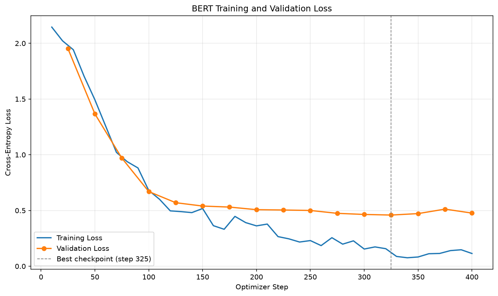
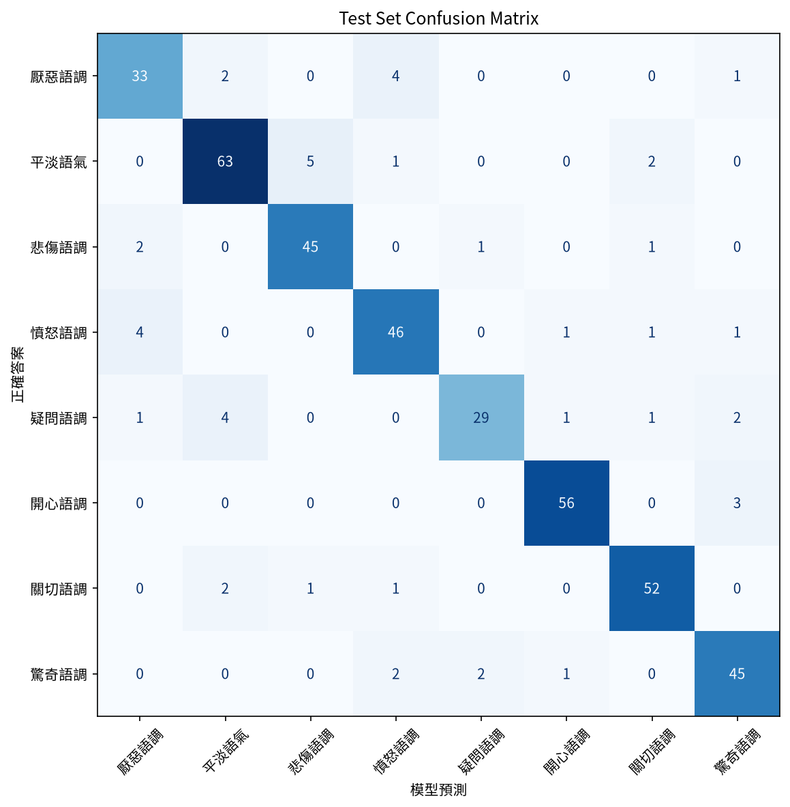

# 作業一教材：BERT 中文情緒分類

> 作業 repo：https://github.com/polun1210/nlp-bert-emotion
> 程式在 `hw1_bert_emotion/`

學完這份教材之後，你應該能把作業的 README 從頭讀到尾，每張圖、每個數字都說得出意思。

```
第 1 章  這個作業在做什麼          （任務是什麼、訓練的是什麼）
第 2 章  必須懂的觀念              （資料 → 模型 → 訓練 → 評估）
第 3 章  五支程式各做了什麼        （觀念對應到程式碼）
第 4 章  看懂成果                  （預測結果、混淆矩陣、曲線）
第 5 章  自我檢測（附答案）
```

---

## 第 1 章：這個作業在做什麼

### 任務一句話

**輸入一句中文，模型判斷它屬於 8 種情緒中的哪一種，並給出信心分數。**

```
"剛剛收到研究所錄取的通知書！"  ──►  [ 模型 ]  ──►  開心語調 (0.9353)
```

這叫做**多元分類（multi-class classification）**：答案有好幾個選項，但每句只能選一個。老師的範例 `bert_finetune` 是**二元分類（binary classification）**，只分正面和負面兩類。作業要你把它改成 8 類。

### 「訓練」到底訓練了什麼？

我們沒有從零開始訓練模型，而是做**微調（fine-tuning）**：

```
                  Google 已經做好的                     我們做的
         ┌─────────────────────────────┐      ┌──────────────────────────┐
         │ 預訓練（pre-training）       │      │ 微調（fine-tuning）       │
         │ 讀了大量中文文章             │ ──►  │ 用 3,323 句有標註的句子   │
         │ 學會「中文怎麼用」           │      │ 教它「分辨情緒」          │
         │ = bert-base-chinese          │      │ = output/ 裡的模型        │
         └─────────────────────────────┘      └──────────────────────────┘
```

可以這樣比喻：BERT 本來就是一個中文很好的人，但從沒做過情緒判斷這份工作。微調就是給他看 3,000 多個例子，讓他學會這份新工作。

具體來說，我們做了兩件事：

1. **在 BERT 後面接一個全新的分類頭（classification head）**：一層 `Linear(768 → 8)`，權重一開始是隨機的。
2. **用我們的資料一起調整整個模型**：分類頭從零學起，BERT 本身的權重也會稍微調整。

---

## 第 2 章：必須懂的觀念

照資料流動的順序來學：

```
 ① 資料準備          ② 轉成數字           ③ 模型              ④ 學習             ⑤ 評估
┌──────────┐      ┌──────────┐      ┌──────────────┐     ┌──────────┐     ┌──────────┐
│ 文字標籤  │      │ Tokenizer │      │ BERT encoder │     │ Loss     │     │ test set │
│ → 整數    │ ──► │ 字 → id   │ ──► │ → [CLS] 向量 │ ──► │ 反向傳播  │ ──► │ 指標      │
│ 切三份    │      │           │      │ → 8 個分數   │     │ 更新權重  │     │ 混淆矩陣  │
└──────────┘      └──────────┘      └──────────────┘     └──────────┘     └──────────┘
```

### ① 資料準備

**標籤編碼（label encoding）**：模型只看得懂數字，所以要把「開心語調」轉成 `5`。對照表存在 `data/label_map.json`：

```
厭惡語調 0   平淡語氣 1   悲傷語調 2   憤怒語調 3
疑問語調 4   開心語調 5   關切語調 6   驚奇語調 7
```

這個表一定要固定。如果訓練時 5 代表開心、推論時 5 代表悲傷，模型的答案就全部對錯號了。

**切成三份資料**，用考試來比喻最好懂：

| 資料 | 比例 | 比喻 | 用途 |
|---|---|---|---|
| train（訓練集） | 80% | 課本習題 | 模型從這裡學 |
| valid（驗證集） | 10% | 模擬考 | 訓練中定期考，用來挑最好的那個時間點 |
| test（測試集） | 10% | 期末考 | 最後只考一次，成績才算數 |

為什麼要有 test？因為我們會拿 valid 的分數挑「最好的那一次」，等於看過模擬考成績才決定交哪份卷子，分數會偏高。test 從頭到尾沒參與任何決定，它的分數才誠實。

還有兩個前處理觀念：

- **資料洩漏（data leakage）**：同一句話如果同時出現在 train 和 test，就等於考前看過考題。所以要先把重複的句子刪掉。
- **分層抽樣（stratified split）**：切資料時讓每份的類別比例都一樣。不然 test 裡的「疑問語調」可能剛好特別少，那一類的分數就不準。

### ② Tokenizer：把字轉成數字

```
"我好開心"
   ↓ tokenizer
[CLS]  我   好   開   心  [SEP]
 101  2769 1962 7274 2552  102     ← input_ids（每個字在字典裡的編號）
  1    1    1    1    1    1       ← attention_mask（1 = 真的字，0 = 補位）
```

- `bert-base-chinese` 大致一個中文字對應一個 token。
- `[CLS]` 放在句首，它的輸出向量最後會用來代表整句話。`[SEP]` 標記句子結束。
- **截斷（truncation）**：句子太長就切掉。我們設 `max_length=128`，因為資料最長的句子只有 92 字。
- **補齊（padding）**：同一批（batch）的句子必須一樣長，短的要補 0。我們用**動態補齊（dynamic padding）**，也就是每一批只補到該批最長的那句，比全部補到 128 省很多計算。

### ③ 模型：BERT 加上分類頭

```
input_ids
   ↓
┌─────────────────────────┐
│  BERT（12 層 Transformer）│   預訓練好的，懂中文
└─────────────────────────┘
   ↓ 取 [CLS] 位置的輸出
 768 維向量（代表整句的意思）
   ↓
┌─────────────────────────┐
│  Linear(768 → 8)         │   新加的分類頭，一開始是隨機的
└─────────────────────────┘
   ↓
logits：[-1.2, 0.3, -0.8, -2.0, 0.1, 4.5, -0.6, 1.1]    ← 8 個原始分數
   ↓ softmax（轉成加總為 1 的機率）
機率：  [0.003, 0.01, 0.005, ... , 0.93, ...]
                                   ↑ index 5 = 開心語調，score = 0.93
```

這裡有兩個名詞：

- **logits**：模型直接輸出的原始分數，可以是負數，加起來也不等於 1。
- **softmax**：把 logits 轉成機率的函數。作業要求印出的 score，就是最高那一類的機率。

二元改成多元，最核心的改動就是 `num_labels=2 → 8`，分類頭從輸出 2 個分數變成輸出 8 個。

### ④ 學習：Loss 和訓練迴圈

**交叉熵損失（cross-entropy loss）** 衡量模型「答錯的程度」：

```
loss = -ln( 模型給正確答案的機率 )

正確答案的機率是 0.93  → loss = 0.07   （很有把握而且答對，loss 小）
正確答案的機率是 0.125 → loss = 2.08   （8 類平均亂猜）
正確答案的機率是 0.01  → loss = 4.6    （很有把握但答錯，loss 大）
```

記住 **ln(8) ≈ 2.08**，第 4 章看 loss 曲線時會用到。

訓練迴圈（training loop）會一直重複下面這個循環：

```
拿一批 32 句 ──► 模型預測 ──► 算 loss ──► 反向傳播（backpropagation）算出每個權重該怎麼調
     ▲                                                    │
     └─────────────── optimizer 更新權重 ◄─────────────────┘
                     （這樣算 1 個 step）
```

| 名詞 | 意思 | 本作業的數字 |
|---|---|---|
| batch size | 一次餵幾句 | 32 |
| step | 更新一次權重 | — |
| epoch | 全部訓練資料看過一輪 | 3323 ÷ 32 ≈ **104 steps** |
| 學習率（learning rate） | 每次調整權重的幅度 | 3e-5（太大會破壞 BERT 原本學到的知識） |
| 暖身（warmup） | 前 50 步讓學習率從 0 慢慢升上去 | 因為分類頭一開始是隨機的，太猛會把 BERT 打亂 |

**過擬合（overfitting）和提前停止（early stopping）**：

```
訓練越久 →
  train loss： 一直下降（習題越寫越熟，甚至開始背答案）
  valid loss： 先下降，之後持平或回升 ← 背答案沒有幫助模擬考，這就是 overfitting
```

所以我們每 25 步考一次模擬考（valid），記下 valid loss 最低的那一次。如果連續 3 次都沒有更好，就提前停止，並載回最好的那一次（`load_best_model_at_end=True`）。

### ⑤ 評估指標

用「開心語調」這一類來說明：

```
                     模型說「開心」
                    ┌──────┬──────┐
                    │  是   │  否  │
          ┌─────────┼──────┼──────┤
真的開心   │   是     │ 答對 │ 漏掉 │
          │   否     │ 誤報 │      │
          └─────────┴──────┴──────┘

精確率 precision = 答對 ÷ (答對 + 誤報)   模型說開心的句子裡，有多少真的是開心？（準不準）
召回率 recall    = 答對 ÷ (答對 + 漏掉)   真的開心的句子裡，模型抓到多少？（漏不漏）
F1               = precision 和 recall 的調和平均，兩者都高，F1 才會高
```

- **準確率（accuracy）**：全部答對的比例。
- **Macro F1**：8 類各自算 F1，再直接平均。每一類權重相同，所以樣本少的類別學得差，分數也會被拉低。二元分類用的 `average="binary"` 在 8 類會直接報錯，所以要改成 macro。

---

## 第 3 章：五支程式各做了什麼

```
data/data.csv（4,159 句，文字標籤）
   │
   │ ① prepare_data.py
   │    去重複（刪掉 5 句）→ 標籤轉整數 → 分層切成 80/10/10
   ▼
train.jsonl (3323)   valid.jsonl (415)   test.jsonl (416)   label_map.json
   │
   │ ② train_bert.py
   │    tokenize → BERT + 8 類分類頭 → 訓練 → 每 25 步看 valid → early stopping
   ▼
checkpoints/（中途存檔，不上傳）     output/（最佳模型 = step 325）
                                       │
           ┌───────────────────────────┼─────────────────────────┐
           ▼                           ▼                         ▼
 ③ evaluate_bert.py           ④ plot_bert_metrics.py      ⑤ infer_bert.py
   用 test 期末考               讀 trainer_state.json        預測作業指定的 5 句
   → 分數表 + 混淆矩陣           → loss / 指標曲線            → 類別 + score
```

| 程式 | 讀什麼 | 產生什麼 | 對應第 2 章 |
|---|---|---|---|
| `prepare_data.py` | `data.csv` | 三份 jsonl + `label_map.json` | ① |
| `train_bert.py` | train / valid jsonl | `output/` 模型、`trainer_state.json` | ②③④ |
| `evaluate_bert.py` | `output/` + test jsonl | `confusion_matrix.png` | ⑤ |
| `plot_bert_metrics.py` | `trainer_state.json` | `loss_curve.png`、`metric_curve.png` | ④ |
| `infer_bert.py` | `output/` | 終端機上的預測結果 | ③ softmax |

`output/` 裡面的檔案：

| 檔案 | 用途 |
|---|---|
| `model.safetensors` | 模型權重本體，390 MB |
| `config.json` | 模型設定，裡面存了 `id2label`，所以推論時會直接印出「開心語調」，而不是 `LABEL_5` |
| `tokenizer.json`、`tokenizer_config.json` | 推論時要用同一套方式把字轉成數字 |
| `trainer_state.json` | 訓練過程中每一步的 loss 紀錄，畫圖用 |

---

## 第 4 章：看懂成果

### 4-1 作業指定的預測

```
我每天都能跟她一起上學，我好開心！ => 開心語調 (0.9839)
```

`0.9839` 是 softmax 之後「開心語調」的機率。8 類的機率加起來是 1，所以其他 7 類一共只分到 0.016。

### 4-2 Loss 曲線（`output/loss_curve.png`）



```
loss
2.0 ┤●  ← 起點約 2.1 ≈ ln(8)，等於 8 類亂猜（分類頭還是隨機的）
    │ ╲
1.0 ┤  ╲    ← 0~150 步：兩條線一起快速下降，模型真的在學
    │   ╲
0.5 ┤    ●━━━━━━━━━━━━●━━━━●━━━●  ← 橘線（valid）卡在 0.46~0.5
    │     ╲___                ┊
0.1 ┤         ╲____________   ┊  ← 藍線（train）繼續降到 0.1：開始背答案 = overfitting
    └──────────────────────────┊────────
    0    100   200   300     325  400 step
                             最佳 ┊ 之後 3 次都沒更好 → 在 400 停下來
```

讀圖重點：

- **起點約 2.1**：剛好等於第 2 章的 ln(8)，代表一開始是隨機亂猜，這是正常的。
- **step 150 之後兩條線分開**：train 還在降，valid 已經降不下去，這是過擬合的訊號。
- **虛線在 325**：valid loss 最低的位置。之後 350、375、400 連續 3 次沒有更好，觸發 early stopping，並載回 step 325 的模型。

### 4-3 指標曲線（`output/metric_curve.png`）


這張是 valid 的 accuracy 和 macro F1。step 25 只有約 0.16，接近亂猜的 1/8 = 0.125，之後很快爬到 0.85 以上，然後持平。它和 loss 圖講的是同一件事，只是從「分數」的角度看。

### 4-4 混淆矩陣（`output/confusion_matrix.png`）



讀法：**列（row）是正確答案，欄（column）是模型的預測。**

```
                     模型預測 →
               厭惡 平淡 悲傷 憤怒 疑問 開心 關切 驚奇
正確  疑問語調 [  1    4    0    0   29    1    1    2 ]  ← 這一列加總 = 38 句
答案
 ↓
```

- **對角線**：答對的數量。對角線顏色越深越好。
- **這一列（疑問語調）**：38 句真正的疑問句，答對 29 句，所以 **recall = 29/38 = 0.763**。另外有 4 句被誤判成平淡。
- **往下看「疑問」這一欄**：模型一共說了 32 次「疑問」，其中 29 次對，所以 **precision = 29/32 = 0.906**。

你可以去對 README 的分數表：疑問語調的 precision 0.9062、recall 0.7632，數字完全一致。這就是分數表和混淆矩陣之間的關係。

非對角線上數字較大的格子，就是模型最常搞混的組合：

- 厭惡和憤怒互相誤判各 4 次，兩者都是強烈的負面情緒。
- 平淡被誤判成悲傷 5 次。

### 4-5 分數表

| 指標 | 數字 | 意思 |
|---|---|---|
| Test accuracy 0.887 | 416 句裡約答對 369 句 | 期末考成績 |
| Macro F1 0.8816 | 8 類平均表現 | 和 accuracy 很接近，代表沒有哪一類特別爛 |
| Valid 0.870 vs test 0.887 | 兩者接近 | 模型不是只對模擬考表現好，而是真的學會了 |

---

## 第 5 章：自我檢測（附答案）

先自己回答，再點開答案對照。

**1. 為什麼文字標籤一定要轉成整數？為什麼對照表要固定，不能每次重新產生？**

<details>
<summary>答案</summary>

- **轉整數**：模型輸出的是 8 個位置的分數，cross-entropy loss 需要知道「第幾個位置是正確答案」，這個位置只能用整數 index 表示。
- **要固定**：模型學到的是「第 5 個位置 = 某種情緒」。如果對照表變了，例如 5 從開心變成悲傷，同一個模型的輸出就全部對錯號。
- `prepare_data.py` 用 `sorted()` 排序，保證每次產生的對照表都一樣；`train_bert.py` 又把它存進 `config.json` 的 `id2label`，推論時直接從模型讀，不會讀錯。

</details>

**2. valid 和 test 都是模型沒訓練過的資料，為什麼還要分兩份？**

<details>
<summary>答案</summary>

valid 雖然沒被拿來訓練，但被拿來**做決定**：挑最佳 checkpoint、判斷什麼時候 early stopping。我們挑的是「在 valid 上表現最好的那一次」，所以 valid 分數會偏樂觀。

test 從頭到尾沒參與任何決定，只在最後評估一次，它的分數才能代表模型面對全新資料的真實表現。

比喻：valid 是模擬考，看了模擬考成績才決定交哪份卷子；test 是期末考。

</details>

**3. Loss 曲線為什麼從 2.1 左右開始？**

<details>
<summary>答案</summary>

一開始分類頭 `Linear(768 → 8)` 是隨機初始化的，模型對 8 類的機率大約平均，每類約 1/8。

cross-entropy loss = -ln(正確答案的機率) = -ln(1/8) = ln(8) ≈ **2.08**。

所以起點 2.1 代表「模型一開始在亂猜」，這是正常的。如果起點遠大於 2.08，反而代表初始化或資料有問題。

</details>

**4. 從 loss 曲線的哪個特徵可以判斷出現了過擬合？**

<details>
<summary>答案</summary>

**train loss 持續下降，valid loss 卻持平或回升，兩條線的差距越拉越大。**

本作業在 step 150 之後，train loss 從 0.5 繼續降到 0.1，valid loss 卻卡在 0.46～0.5；step 325 之後 valid loss 還開始回升。代表模型在背訓練資料的答案，這些背下來的東西對沒看過的資料沒有幫助。

</details>

**5. 混淆矩陣中「平淡語氣」那一列是 `0 63 5 1 0 0 2 0`，它的 recall 是多少？**

<details>
<summary>答案</summary>

列是正確答案，所以這一列的總和就是「真的是平淡語氣」的句子數：

```
0 + 63 + 5 + 1 + 0 + 0 + 2 + 0 = 71 句
```

其中對角線的 63 句答對：

```
recall = 63 / 71 = 0.8873
```

和 README 分數表的平淡語氣 recall 0.8873 一致。另外 5 句被誤判成悲傷，是這一列最大的錯誤。

</details>

**6. 二元分類改成 8 類，程式裡哪三個地方一定要改？**

<details>
<summary>答案</summary>

| 地方 | 改法 | 不改會怎樣 |
|---|---|---|
| `num_labels` | 2 → 8 | 分類頭只輸出 2 個分數，標籤 2～7 會讓 loss 計算報錯 |
| `id2label` / `label2id` | 從寫死的 NEGATIVE / POSITIVE 改成讀 `label_map.json` | 推論結果只會顯示 `LABEL_5`，看不到「開心語調」 |
| F1 的 `average` | `"binary"` → `"macro"` | `average="binary"` 只能用在兩類，8 類會直接報錯 |

資料前處理也要多做一步：把中文標籤轉成 0～7 的整數（第 1 題）。

Loss 不用改：`num_labels > 1` 且標籤是整數時，模型會自動使用 CrossEntropyLoss，二元和多元用的是同一套。

</details>

---

## 延伸練習

- 在 `infer_bert.py` 的 `TEST_TEXTS` 加入你自己寫的句子，觀察模型在哪些句子上猶豫（看前 3 名機率）。
- 把 `LEARNING_RATE` 改成 `1e-4`（老師範例的值）重新訓練，比較 loss 曲線有什麼不同。
