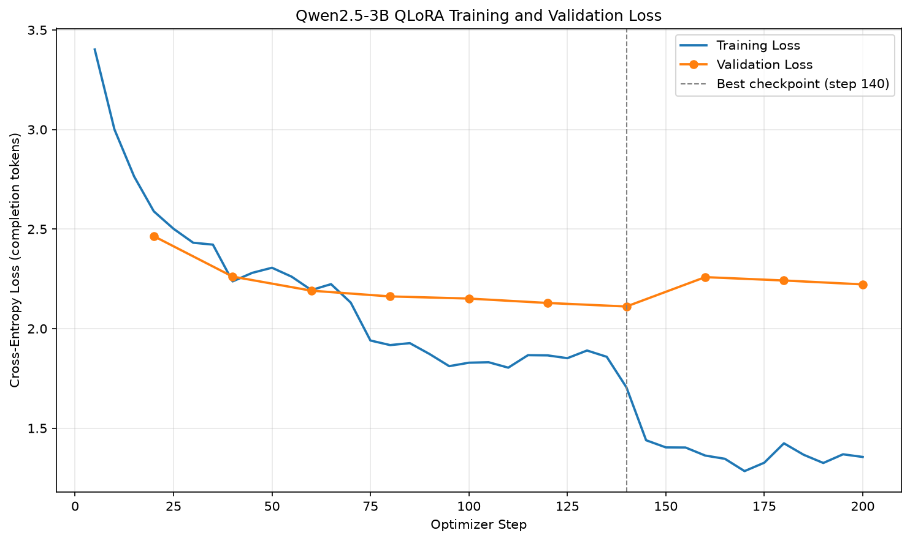

# 作業二教材：微調 LLM 成為多輪對話的土味情話專家

> 作業 repo：https://github.com/polun1210/nlp-pickup-lines-chat
> 程式在 `hw2_pickup_lines/`

學完這份教材，你應該能看懂作業二的 README、每支程式在做什麼，以及 loss 曲線和展示對話代表的意思。

```
第 1 章  這個作業在做什麼          （分類 vs 生成、要訓練什麼）
第 2 章  必須懂的觀念              （下一個 token、chat template、SFT、LoRA/QLoRA、生成參數）
第 3 章  程式各做了什麼            （觀念對應到程式碼）
第 4 章  看懂成果                  （loss 曲線、微調前後對照、1.5B vs 3B）
第 5 章  自我檢測（附答案）
```

---

## 第 1 章：這個作業在做什麼

### 任務一句話

**微調一個會說話的語言模型，讓它變成「土味情話專家」，並且能接著前面的對話繼續聊（至少 2 輪）。**

```
你：教我如何透過長相來認識女性朋友。
專家：你就跟他說「你長得很像我一個朋友」。
你：長得像你朋友？                          ← 第 2 輪：沒有重講情境
專家：沒錯，跟她說「你長得像我下一任女朋友」。 ← 專家必須記得上一輪在聊什麼
```

### 和作業一的差別

```
作業一：分類（BERT）                    作業二：生成（LLM）
┌──────────────────────────┐           ┌──────────────────────────────────┐
│ "我好開心" → [8 選 1]     │           │ 前面的對話 → 一個字一個字寫出回答   │
│            → 開心語調     │           │                                  │
└──────────────────────────┘           └──────────────────────────────────┘
 模型：BERT（1 億參數）+ 分類頭           模型：Qwen2.5-3B-Instruct（31 億參數）
                                         （另外訓練 1.5B 做比較）
 答案：8 個選項之一                      答案：沒有標準答案，任何通順的句子都可能
 微調：整個模型都更新                    微調：LoRA，只訓練外掛的約 1% 參數
 評估：accuracy、F1                      評估：loss + 人眼看對話品質
```

### 訓練了什麼？

我們沒有教模型「說中文」或「怎麼對話」。Qwen2.5-Instruct 已經會了，Instruct 代表它被訓練過聽指令、照對話格式回答。

我們教的是**說話風格**：

| | 原本的 Qwen | 微調後 |
|---|---|---|
| 長度 | 一則 100～200 字 | 1～3 句 |
| 內容 | 說教、列建議（「最重要的是真誠」） | 直接給一句能講出口的情話 |
| 接話 | 每輪各說各的 | 沿用上一輪的梗反轉 |

---

## 第 2 章：必須懂的觀念

```
 ① 語料               ② 排成模型的格式        ③ 展開成訓練資料        ④ 模型與 LoRA          ⑤ 生成
┌────────────┐     ┌────────────────┐     ┌────────────────┐     ┌──────────────┐     ┌──────────────┐
│ 400 段      │     │ chat template   │     │ prompt →        │     │ 4-bit Qwen   │     │ 重送整段對話  │
│ 多輪對話    │ ──► │ <|im_start|>... │ ──► │ completion      │ ──► │ + LoRA       │ ──► │ temperature   │
│ （自己準備） │     │                 │     │ 只對回答算 loss │     │ 只訓練 1.2%  │     │ 逐字產生      │
└────────────┘     └────────────────┘     └────────────────┘     └──────────────┘     └──────────────┘
```

### ① 語料：自己準備的多輪對話

作業沒有現成資料集，老師建議跟 AI 討論來產生語料。我們的做法：

1. 先寫一份**語料規範**（`corpus_guidelines.md`）：格式、風格、範例。
2. 分 8 個主題各產生 50 段，主題分別是校園、職場、食物、節日天氣、科技、學科梗、日常生活、情侶之間。
3. 用程式檢查格式、去除重複、抽樣人工檢查。

規範裡最重要的一條：**第二輪之後，使用者的話一定要接著上一輪**，例如對方怎麼回、吐槽太油、追問下一步。專家也要沿用上一輪的梗。模型的「多輪能力」就是從這裡學來的；如果每輪都是不相關的新問題，模型只會學到單輪問答。

### ② 語言模型在做什麼：預測下一個 token

LLM 只做一件事：**看前面所有的字，猜下一個 token（詞元）是什麼。** 一直重複這件事，就寫出了一整段話。

```
輸入：那就接：「那我下次再來
模型：下一個 token 最可能是「臨」(35%)、「找」(20%)、「銀」(8%)…
選了「臨」→ 接在後面 → 再猜下一個 →「櫃」→ …→ <|im_end|>（結束）
```

- **token**：模型處理文字的單位。Qwen 的詞彙表有約 15 萬個 token，常見的詞會合成一個 token（例如「那就」）。實測一句 31 字的回答是 24 個 token。
- **loss**：和作業一一樣是交叉熵（cross-entropy），只是這次是**每個 token 都算一次**「猜對下一個 token 的機率」，再平均。
- 15 萬選 1 亂猜的 loss 是 ln(151,665) ≈ 11.9。但我們的起點只有約 3.2，因為 Qwen 本來就很會猜中文。所以這次 loss 的下降代表**學會這種風格**，而不是學會說話。

### ③ Chat template：多輪對話怎麼排成一條文字

模型只看得懂「一條很長的 token 序列」，不懂什麼是「多輪」。Chat template 用特殊 token 把每則訊息的角色標清楚。這是一筆真實訓練資料套上 Qwen 模板之後的樣子：

```
<|im_start|>system
你是一位土味情話高手，會以親切、溫和、帶點俏皮的口吻回答使用者的問題。…<|im_end|>
<|im_start|>user
去銀行辦事，櫃台的男行員很帥，我是女生，可以說什麼？<|im_end|>
<|im_start|>assistant
辦完事時說：「謝謝你，順便問一下，你們有沒有開放存一種東西，叫做好感？」<|im_end|>
<|im_start|>user
他說「這個要本人臨櫃辦理喔」。<|im_end|>
<|im_start|>assistant
那就接：「那我下次再來臨櫃，不過可以先預約你下班後的時間嗎？」<|im_end|>   ← 要學的部分
```

- `<|im_start|>角色` 和 `<|im_end|>` 是特殊 token，標記一則訊息的開始和結束。
- 每個模型的模板都不一樣，要用 `tokenizer.apply_chat_template()` 產生，不能自己拼字串。
- 模型要學會在回答完時輸出 `<|im_end|>`，推論時才知道什麼時候停下來。這就是程式裡 `eos_token="<|im_end|>"` 的用途。

### ④ SFT：一段對話展開成好幾筆訓練資料

**監督式微調（Supervised Fine-Tuning, SFT）**：給模型看「題目 → 標準答案」，讓它模仿。

一段 3 輪的對話會展開成 3 筆訓練資料，每一個專家回答都是一個「標準答案」：

```
一段 3 輪的對話                     展開成 3 筆（prompt → completion）
┌─────────────────────┐
│ system  人設         │           ① [S, U1]             → A1
│ user    U1           │           ② [S, U1, A1, U2]     → A2   ← 要看懂前文才答得出來
│ asst    A1           │    ──►    ③ [S, U1, A1, U2,
│ user    U2           │                  A2, U3]        → A3   ← 多輪能力就是在這裡學的
│ asst    A2           │
│ user    U3           │
│ asst    A3           │
└─────────────────────┘
```

本作業：400 段對話 → 切成 train 360 段、valid 40 段 → 展開成 **1,104 筆 train、124 筆 valid**。

兩個重點：

- **先切 train/valid，再展開**：如果先展開再切，② 可能在 valid、① 在 train，而 ② 的題目裡就包含 train 看過的 U1、A1。這是資料洩漏（data leakage），作業一講過同樣的觀念。
- **只對回答算 loss（completion-only loss）**：prompt 只是題目，不要求模型學會寫出 system 和使用者說的話。不然模型會花力氣模仿「使用者怎麼問」，而不是「專家怎麼答」。設定是 `completion_only_loss=True`。

### ⑤ LoRA 與 QLoRA：只訓練一小部分

> 這一節用 1.5B 的數字當例子（hidden size 1536）。3B 的 hidden size 是 2048，原理完全一樣。

**為什麼不能像作業一那樣整個模型一起調？**

```
全模型微調需要的 GPU 記憶體（粗估，1.5B 參數）：
    權重          1.5B × 2 bytes (BF16)  ≈  3 GB
    梯度          1.5B × 2 bytes         ≈  3 GB
    optimizer 狀態 1.5B × 8 bytes (AdamW) ≈ 12 GB
                                    合計 ≈ 18 GB 以上 → 16 GB 顯卡放不下
```

**LoRA（Low-Rank Adaptation，低秩適應）**：凍結原本的權重 W，在旁邊加兩個很小的矩陣 A、B，只訓練 A、B：

```
            ┌──────────────┐
  x ──┬────►│ W（凍結）     │────┐
      │     │ 1536 × 1536  │    │
      │     └──────────────┘    ▼
      │                        (+) ──► 輸出 = W·x + B·A·x
      │     ┌─────┐  ┌─────┐    ▲
      └────►│  A  │─►│  B  │────┘
            │1536×16│ │16×1536│   ← 只訓練這兩個（r = 16）
            └─────┘  └─────┘
```

- **rank（r）**：A、B 中間的寬度。原本一層有 1536 × 1536 ≈ 236 萬個參數，LoRA 只需要 2 × 1536 × 16 ≈ 4.9 萬個。
- 本作業所有 linear layer 都加 LoRA（`target_modules="all-linear"`）。可訓練參數：1.5B 是 **18,464,768 個（1.18%）**，3B 是 **29,933,568 個（0.96%）**。
- **lora_alpha**：控制 LoRA 輸出放大的倍數，常設成 2 × r。
- 存檔只需要存 A、B，也就是 **adapter**：1.5B 是 71 MB，3B 是 115 MB。推論時再接回原本的模型。3B 的超過 GitHub 單檔 100 MB 的上限，所以要用 Git LFS。

**QLoRA = 4-bit 量化（Quantization）+ LoRA**：凍結的 W 用 4-bit 存，記憶體再省 3/4：

| | 每個參數 | 1.5B 模型的權重 |
|---|---|---|
| BF16 | 2 bytes | 約 3 GB |
| 4-bit NF4 | 0.5 byte | 約 1 GB |

- **NF4（NormalFloat4）**：針對神經網路權重常見的常態分布設計的 4-bit 格式。
- 「存」是 4-bit，「算」的時候會暫時還原成 BF16（`bnb_4bit_compute_dtype`），所以精度損失不大。
- 老師的範例是針對 Colab T4 寫的。T4 不支援 BF16，所以要用 FP16 並把 LoRA 參數強制轉成 FP32。RTX 50 系列原生支援 BF16，這些修補都不需要。

### ⑥ 訓練設定

| 參數 | 值 | 說明 |
|---|---|---|
| 有效 batch size | 8 × 2 = 16 | `per_device_train_batch_size × gradient_accumulation_steps` |
| 每個 epoch | 1,104 ÷ 16 ≈ **69 steps** | 第 4 章看曲線會用到 |
| learning rate | 1e-4 | LoRA 參數少，常用的學習率比全模型微調（作業一 3e-5）大 |
| warmup | 前 20 steps | 剛接上的 LoRA 先小步調整 |
| 驗證 | 每 20 steps | 用 valid 的 loss 挑最佳 checkpoint |
| early stopping | 連續 3 次沒改善就停 | 和作業一相同 |

### ⑦ 推論：多輪對話其實是「每次重送整段對話」

**模型本身沒有記憶。** 多輪對話的「記得上文」是程式做出來的：

```
第 1 輪送進模型：[system, user1]                          → assistant1
第 2 輪送進模型：[system, user1, assistant1, user2]       → assistant2
第 3 輪送進模型：[system, user1, assistant1, user2,
                  assistant2, user3]                      → assistant3
```

每一輪都把到目前為止的整段對話重新送進去。對話太長時，只保留最近幾輪（`MAX_HISTORY_TURNS`）。

**生成參數**：模型每一步會得到 15 萬個 token 的機率，要怎麼選？

| 參數 | 本作業 | 意思 |
|---|---|---|
| `temperature` | 0.7 | 小於 1 讓高機率的更突出，比較穩定；越大越隨機、越有創意 |
| `top_p` | 0.9 | 只從累積機率前 90% 的候選裡抽，排除很離譜的 token |
| `repetition_penalty` | 1.1 | 降低已經出現過的 token 的機率，避免一直重複 |
| `max_new_tokens` | 200 | 最多產生多少 token |

因為有隨機抽樣（`do_sample=True`），同樣的問題每次回答會不一樣。

---

## 第 3 章：程式各做了什麼

```
data/raw/*.jsonl（8 個主題 × 50 段）
   │ ① build_corpus.py   檢查格式 → 去重 → 每段前面加上 system prompt
   ▼
data/chat.jsonl（400 段）
   │ ② prepare_chat_data.py   以「整段對話」切 90/10 → 展開成 prompt/completion
   ▼
data/sft/train.jsonl (1104)   valid.jsonl (124)
   │ ③ train_qlora.py   4-bit Qwen + LoRA → SFTTrainer → early stopping（--model 3b / 1.5b）
   ▼
outputs/qwen25_3b_lora/（交作業的 adapter，115 MB）、qwen25_15b_lora/（比較用）
   ├─ ④ plot_loss.py         → loss_curve.png
   ├─ ⑤ infer_lora_chat.py   → 互動聊天 / --demo 展示 / --base 對照原始模型
   └─ ⑥ compare_models.py    → 用沒看過的 validation 對話比較 原始 / 1.5B / 3B
```

| 程式 | 改寫自老師的 | 主要改動 |
|---|---|---|
| `build_corpus.py` | `download_chat_data.py` | 老師下載現成資料集；我們合併自己的語料，加上格式檢查 |
| `prepare_chat_data.py` | 同名 | 保留的上下文 6 → 8 則，避免第 4 輪把開場情境切掉 |
| `train_qlora.py` | 同名 | 0.5B → 3B / 1.5B、FP16 → BF16、LoRA r 8 → 16 |
| `plot_loss.py` | 同名 | 標出最佳 checkpoint |
| `infer_lora_chat.py` | 同名 | 加上 `--demo` 自動展示、`--base` 關掉 LoRA 對照 |
| `compare_models.py` | （新增） | 用 validation 對話、同一個 seed 公平比較多個模型 |

`--base` 是靠 `model.disable_adapter()` 實現的：暫時拔掉 LoRA，同一個模型就變回原本的 Qwen。不用另外載入一份模型，就能公平比較微調前後的差別。

---

## 第 4 章：看懂成果

### 4-1 Loss 曲線

以 1.5B 為例（3B 的形狀幾乎一樣，見 4-3）：


```
train loss
3.2 ┤╲
    │ ╲
2.6 ┤  ╲___         ●━━━●━━━●━━━● valid（step 140 最低 2.35，之後回升）
    │      ╲___     ┊
2.1 ┤          ╲____┊____  ← step ~70 掉一階：開始第 2 次看同一批資料
    │               ┊    ╲
1.7 ┤               ┊     ╲_______  ← step ~140 又掉一階：第 3 次
    └───────────────┊──────────────
    0    70        140        200 step
                  最佳
```

讀圖重點：

- **階梯狀下降**：每個 epoch 約 69 步。train loss 剛好在 step 70、140 往下掉一階，因為模型第二次、第三次看到同樣的資料，記住了一部分。這是背答案的典型訊號，作業一的曲線比較看不出來，這次非常明顯。
- **valid 在 step 140 之後回升**：背下來的內容對沒看過的對話沒有幫助，也就是過擬合（overfitting）。Early stopping 在 step 200 停止，並載回 step 140 的模型。
- **valid loss 最低只到 2.35**：分類只有 8 個選項；這裡每個字都有很多合理的寫法，情話本來就沒有標準答案，loss 降不到很低是正常的。**生成任務的 loss 只能當參考，最後還是要看實際對話。**

### 4-2 微調前後對照（同一段對話）

用 `python infer_lora_chat.py --demo` 和 `--demo --base` 跑同樣的問題：

| | 原始 Qwen2.5-1.5B | 微調後 |
|---|---|---|
| 長度 | 一則 100～200 字，像客服 | 1～3 句 |
| 格式 | 說教、列建議，引號用 `“”` | 情話用「」，給一句能直接講的話 |
| 用字 | 夾雜簡體（`一句话`、`选择`） | 全部繁體 |
| 接話 | 把「你好無聊喔」解讀成「親密的玩笑語，趁熱打鐵」 | 「大方承認…如果她主動搭話就繼續當朋友；別硬拉」 |
| 角色 | 第 3 段開始把自己當成被搭訕的人 | 一直維持顧問角色 |

結論：**風格、長度、格式、接話的方式都學會了；但「梗」的邏輯有時不通**，例如「你的臉型很適合當我的鏡頭」。這是 1.5B 模型容量的限制。

### 4-3 1.5B vs 3B



| | 1.5B | 3B |
|---|---|---|
| 最佳 validation loss | 2.351 | **2.111** |
| 最佳 checkpoint | step 140 | step 140 |
| 可訓練參數 | 18.5M（1.18%） | 29.9M（0.96%） |
| 訓練時間 | 4.8 分鐘 | 7.7 分鐘 |
| adapter | 71 MB | 115 MB（要用 Git LFS） |

**loss 低不代表回答一定比較好**，所以另外寫了 `compare_models.py` 做公平比較：

```
validation 的 6 段對話（訓練時沒看過）
   │ 使用者每一輪的話：照語料原文
   │ 專家的回答：交給模型產生
   │ 每個模型：同一個 seed、同樣的生成參數
   ▼
原始 1.5B ｜ 1.5B + LoRA ｜ 3B + LoRA ｜ 語料參考答案  並列比較
```

為什麼使用者的話要照語料原文，而不是讓模型自由聊？因為這樣每個模型面對的是**完全一樣的題目**，差異只來自模型本身。

比較結果（完整內容在 repo 的 `outputs/compare_models.md`）：

| | 好的例子 | 失誤 |
|---|---|---|
| 1.5B + LoRA | 「沒關係，中途休息一下就好，就像你跑步停下來喝水一樣。」 | 常變成一般建議，沒有梗：「謝謝你今天願意陪我吃，下次有好吃的記得約我。」 |
| 3B + LoRA | 「我沒有在你們班，但我有在你心裡。」「今天的配速先歸零。」 | 「另一個是我的女朋友」（不恰當）、「荣幸」（簡體字） |

結論：**3B 比較會用「鋪梗 → 反轉」接住上一輪，所以作業交 3B**。兩個模型都還有邏輯不通、偶爾不恰當的回答，README 照實列在「還做不好的地方」。

這也是生成任務評估的重點：**loss 當作挑 checkpoint 的依據，最後一定要看實際輸出。**

---

## 第 5 章：自我檢測（附答案）

**1. 作業二的 loss 起點約 3.2，遠低於 15 萬類亂猜的 11.9，為什麼？**

<details>
<summary>答案</summary>

Qwen2.5-Instruct 已經是很會說中文的對話模型，本來就能猜中大部分的下一個 token。所以起點不是亂猜。

loss 從 3.2 降到 2.35，代表模型學會了**這種說話風格**：用詞、句型、長度，而不是從頭學會說話。對比作業一：BERT 的分類頭是隨機初始化的，所以起點剛好是 ln(8) ≈ 2.08。

</details>

**2. 為什麼一段 3 輪的對話要展開成 3 筆訓練資料？只用最後一輪不行嗎？**

<details>
<summary>答案</summary>

每一個專家回答都是一個值得學的標準答案，展開可以充分利用語料。

更重要的是，第 2、3 筆的 prompt 裡有前面的對話，模型必須讀懂上文才寫得出接得上的回答，這正是作業要求的多輪能力。只用最後一輪的話，第 1 輪（沒有上文的開場回答）就學不到了。

</details>

**3. `completion_only_loss=True` 是什麼意思？不設會怎樣？**

<details>
<summary>答案</summary>

只對 completion（專家的回答）的 token 計算 loss；prompt（system、使用者的話、前幾輪）只當作題目，不要求模型學會寫出來。

不設的話，模型也會被訓練去模仿使用者的問法和 system prompt。訓練的力氣被分散，而且推論時模型可能開始「替使用者說話」。

</details>

**4. LoRA 為什麼能省記憶體？r = 16 代表什麼？**

<details>
<summary>答案</summary>

原本的權重 W 凍結不更新，不需要存它的梯度和 optimizer 狀態，而這兩項才是記憶體的大宗。只訓練旁邊的小矩陣 A（d × r）和 B（r × d），r = 16 就是它們中間的寬度。

一層 1536 × 1536 的權重有約 236 萬個參數，LoRA 只需要 2 × 1536 × 16 ≈ 4.9 萬個。整個模型的可訓練參數只有 1.18%。

QLoRA 再把凍結的 W 用 4-bit 存，權重本身的記憶體也省下約 3/4。

</details>

**5. 模型沒有記憶，那多輪對話是怎麼「記得上文」的？**

<details>
<summary>答案</summary>

推論程式每一輪都把「到目前為止的整段對話」（system + 所有 user / assistant 訊息）重新套上 chat template 送進模型。模型每次都是從頭讀完整段對話，才產生下一個回答。

所以對話越長，送進去的 token 越多、越慢，程式會用 `MAX_HISTORY_TURNS` 只保留最近幾輪。

</details>

**6. 從 loss 曲線的哪個特徵可以看出模型在背答案？**

<details>
<summary>答案</summary>

兩個特徵：

1. **train loss 呈階梯狀下降**，掉落的位置剛好是每個 epoch 的開頭（step 70、140）。代表模型再次看到同樣的資料時，loss 突然變低，也就是記住了。
2. **valid loss 在 step 140 之後回升**，train 和 valid 的差距越拉越大。

Early stopping 因此在 step 200 停止，並載回 valid loss 最低的 step 140。

</details>

**7. 3B 的 validation loss 比 1.5B 低，為什麼還要另外跑 `compare_models.py`？**

<details>
<summary>答案</summary>

loss 衡量的是「模型的寫法有多接近語料裡的參考答案」，但情話沒有標準答案：一句跟參考答案完全不同、卻很好笑的回答，loss 反而會比較高。

所以 loss 只適合拿來挑 checkpoint、比較大致趨勢。要判斷哪個模型比較好，還是要用同樣的題目（沒看過的 validation 對話）、同樣的 seed，實際看產生的對話。

</details>

**8. `--base` 模式怎麼做到不用另外載入原始模型？**

<details>
<summary>答案</summary>

PEFT 模型可以用 `model.disable_adapter()` 暫時停用 LoRA。在這個 context 裡產生回答，輸出就只來自原本的權重 W，等於原始的 Qwen2.5-1.5B-Instruct。離開 context 後 LoRA 自動恢復。

同一份模型、同樣的生成參數，只差在有沒有 LoRA，比較才公平。

</details>

---

## 延伸練習

- 執行 `python infer_lora_chat.py`，用自己的情境多聊幾輪，找出模型最容易接不上話的情況。
- 把 `TEMPERATURE` 改成 0.3 和 1.0，比較回答的穩定度和創意。
- 在 `data/raw/` 加入你自己寫的 20 段對話，重新訓練，看看模型有沒有學到你的風格。
