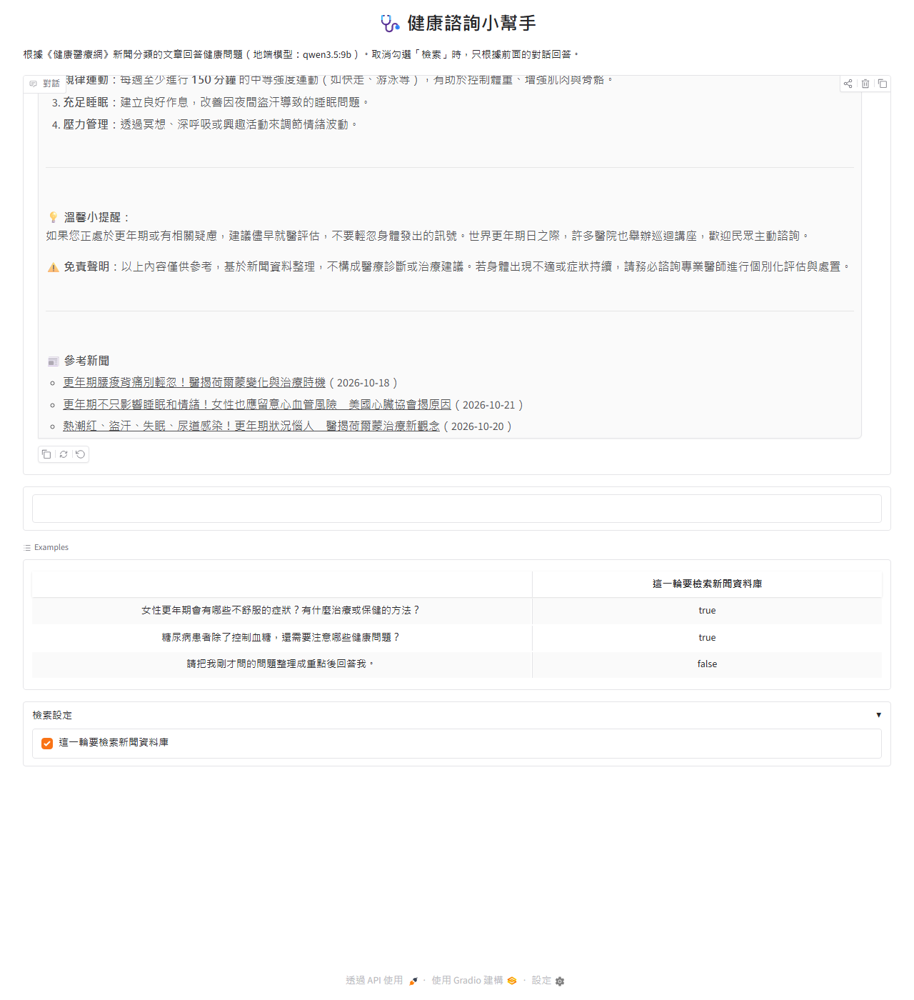
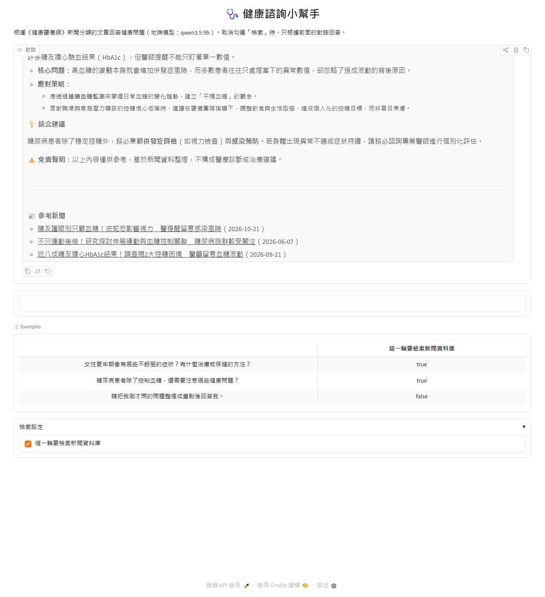
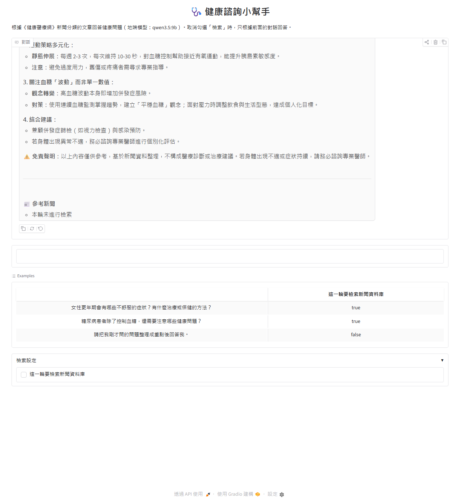

# 作業三教材：用 RAG 建立健康諮詢小幫手

> 作業 repo：https://github.com/polun1210/nlp-health-rag
> 程式在 `hw3_health_rag/`

學完這份教材，你應該能看懂作業三的 README、每支程式在做什麼，以及網頁上的回答和「參考新聞」是怎麼來的。

```
第 1 章  這個作業在做什麼          （RAG 是什麼、為什麼需要）
第 2 章  必須懂的觀念              （爬蟲、資料庫、摘要、向量、檢索、組 prompt）
第 3 章  程式各做了什麼            （觀念對應到程式碼）
第 4 章  看懂成果                  （資料庫、檢索分數、展示對話、網頁）
第 5 章  自我檢測（附答案）
```

---

## 第 1 章：這個作業在做什麼

### 任務一句話

**爬下《健康醫療網》的新聞，建成可以搜尋的資料庫；使用者問健康問題時，先找出相關新聞，再讓地端模型根據新聞回答，並附上新聞出處。**

### 為什麼需要 RAG？

直接問語言模型會有三個問題：

| 問題 | 例子 |
|---|---|
| 知識有截止日 | 模型訓練完之後的新聞，它不知道 |
| 會一本正經地編造 | 編出不存在的研究數據、醫師說法（幻覺，hallucination） |
| 沒有出處 | 使用者無法查證 |

**RAG（Retrieval-Augmented Generation，檢索增強生成）** 的做法是先查資料、再回答，像開書考試：

```
                 沒有 RAG                                 有 RAG
       ┌─────────────────────┐            ┌──────────────────────────────────────┐
問題 ─►│ 模型憑記憶回答        │    問題 ─►│ ① 檢索：從新聞資料庫找出最相關的 3 篇  │
       │（可能過時、可能編造） │            │ ② 把 3 篇新聞和問題一起交給模型        │
       └─────────────────────┘            │ ③ 模型根據新聞回答                    │
                                          │ ④ 附上新聞標題、連結、日期             │
                                          └──────────────────────────────────────┘
```

### 和作業一、二的差別

| | 作業一 | 作業二 | 作業三 |
|---|---|---|---|
| 有沒有訓練模型 | 有（微調 BERT） | 有（LoRA 微調 Qwen） | **沒有** |
| 讓模型變好的方法 | 改權重 | 改權重 | **改 prompt**：把相關資料放進去 |
| 新增知識的成本 | 重新訓練 | 重新訓練 | 爬新文章、重建索引，幾分鐘就好 |

作業三一個模型都不用訓練。全部的工夫在**資料**：怎麼爬、怎麼存、怎麼找到相關的那幾篇。

---

## 第 2 章：必須懂的觀念

整個系統分成兩個階段：

```
【離線建置】事先做一次                              【線上問答】每次提問
                                                  
 健康醫療網                                         使用者問題
     │ ① 爬蟲                                          │
     ▼                                                 │ ⑤ 轉成向量（同一個 bge-m3）
 標題、全文、連結、日期                                 ▼
     │ ② 地端模型摘要（qwen3.5:9b）                 問題向量
     ▼                                                 │ ⑥ FAISS 找最相似的 3 篇
 + 摘要                                                ▼
     │ ③ 存進 SQLite                              id → 回資料庫查標題、摘要、連結、日期
     ▼                                                 │ ⑦ 組 prompt
 news.db ─────────────────────────────────────►       ▼
     │ ④ 摘要轉向量（bge-m3）                      地端模型（qwen3.5:9b）回答
     ▼                                                 │ ⑧ 附上參考新聞
 vector.index ────────────────────────────────►       ▼
                                                   網頁顯示
```

### ① 爬蟲（web crawler）

用程式下載網頁，再從 HTML 裡取出需要的資料。

```
requests.get(網址)          → 下載 HTML
BeautifulSoup(html, "lxml") → 解析成樹狀結構
soup.select("div#article-title") → 用 CSS 選擇器取出元素
```

兩層爬取，和老師範例相同：

```
分類列表頁（每頁 8 篇）                     新聞內頁
┌───────────────────────────┐           ┌──────────────────────┐
│ ▸ 標題 A   記者 X  10-21   │ ──連結──► │ div#article-title    │ → 標題
│ ▸ 標題 B   記者 Y  10-20   │           │ div#article-content  │ → 全文
│ ...                       │           └──────────────────────┘
└───────────────────────────┘
  ul.list-unstyled > li.list-item
  取出：連結、記者、日期、分類
```

爬蟲禮儀：
- 先看 **robots.txt**：網站告訴爬蟲哪些路徑不能抓。健康醫療網只禁止 `/rss_file/`，新聞頁可以抓。
- 每次請求之間**隨機等待 1～3 秒**，避免對網站造成負擔。
- 失敗要**重試**，不要讓一次逾時就讓整支程式中斷。

本作業爬「新聞分類」底下的 9 個子分類，每類 3 頁。同一篇新聞可能同時出現在好幾個分類，所以用連結去重，最後得到 178 篇。

### ② 文章摘要：用地端模型產生

**地端模型（local model）**：在自己電腦上執行的模型，資料不會傳到外部。本作業用 **Ollama** 執行 `qwen3.5:9b`。

```
Ollama（背景服務，localhost:11434）
   ▲
   │ HTTP API
   │
Python：client.chat(model="qwen3.5:9b", messages=[...])
```

為什麼要先做摘要，不直接拿全文轉向量？
1. 全文中位數 1,300 字，混著醫師經歷、活動資訊等枝節。整篇壓成一個向量後，主題會被稀釋。
2. 回答時要把檢索結果塞進 prompt。3 篇摘要只有幾百字，3 篇全文可能好幾千字，模型比較抓不到重點。

`think=False`：Qwen3.5 預設會先輸出一段「思考過程」再回答。摘要不需要推理，關掉比較快。

### ③ 資料庫：SQLite

作業要求的欄位和資料表的對應：

| 作業要求 | 欄位 | 型態 |
|---|---|---|
| 流水號 | `id` | `INTEGER PRIMARY KEY AUTOINCREMENT`，自動遞增 |
| 新聞標題 | `title` | TEXT |
| 新聞連結 | `link` | TEXT `UNIQUE`，同一篇不會存兩次 |
| 文章全文 | `content` | TEXT |
| 文章摘要 | `summary` | TEXT |
| 文章新增時間 | `published_at` | TEXT，新聞在網站上的發布日期 |

另外多存了 `category`（分類）、`reporter`（記者）、`created_at`（寫入資料庫的時間）。

SQLite 是 Python 內建的資料庫：不用架伺服器，整個資料庫就是一個 `news.db` 檔案。

### ④ 向量（embedding）：把文字變成一串數字

**embedding 模型**把一段文字轉成一個固定長度的向量。意思相近的文字，向量也會很接近。

```
"更年期熱潮紅怎麼辦"     → [0.12, -0.03, 0.88, ...]  (1024 個數字)
"停經前後盜汗失眠"       → [0.10, -0.01, 0.85, ...]  ← 很接近
"糖尿病患要注意眼睛"     → [-0.40, 0.67, 0.02, ...]  ← 差很遠
```

本作業用老師範例的 **BAAI/bge-m3**：支援中文，每段文字轉成 **1024 維**向量。

和作業一的 BERT 比較：作業一是用 `[CLS]` 向量接分類頭做分類；embedding 模型是專門訓練來讓「意思相近 → 向量相近」，直接拿向量來比較相似度。

**相似度：cosine similarity**

```
              A · B
cos(A, B) = ─────────     範圍 -1～1，越接近 1 越相似
             |A| |B|
```

如果先把向量 **normalize**（長度變成 1），分母就是 1，cosine similarity 等於**內積（inner product）**，計算更快。這就是程式裡 `normalize_embeddings=True` 搭配 `faiss.IndexFlatIP` 的原因。

### ⑤ 向量索引：FAISS

**FAISS**（Facebook AI Similarity Search）：給一個查詢向量，快速找出最相似的 K 個向量。

```python
index = faiss.IndexIDMap(faiss.IndexFlatIP(1024))
index.add_with_ids(向量們, 資料庫id們)
scores, ids = index.search(問題向量, k=3)
```

- `IndexFlatIP`：Flat = 暴力比對每一個向量，IP = 用內積計分。178 篇很少，暴力比對不到 1 毫秒。資料到百萬篇才需要近似搜尋的索引。
- `IndexIDMap`：讓每個向量綁定資料庫的 `id`。檢索結果直接是 `id`，再用 `SELECT ... WHERE id = ?` 查出標題、連結、日期。

### ⑥ 檢索的細節

**相似度門檻**：FAISS 一定會回傳 K 篇，就算都不相關。所以要設門檻 `MIN_SCORE`，分數太低的丟掉，免得把無關的新聞塞給模型，或列成參考新聞誤導使用者。

門檻要用實測決定。一開始我設 0.45，實測後發現太低：

| 問題 | 最高分 | 實際結果 |
|---|---|---|
| 更年期有哪些症狀 | 0.693 | 3 篇都是更年期新聞 |
| 糖尿病要注意什麼 | 0.642 | 3 篇都是糖尿病新聞 |
| 怎麼修電腦（無關） | 0.519 | 網路成癮、冷氣病…… |

bge-m3 對無關的問題也會給到 0.5 左右，所以門檻改成兩群中間的 **0.58**。

**追問的檢索**：使用者常常會追問「那要怎麼預防？」，這句話本身沒有主題，拿去檢索會找不到東西。做法是：

```
先只用本輪問題檢索
   ├─ 找到相關新聞（分數 ≥ 門檻）→ 直接用
   └─ 找不到 → 把上一個問題一起帶上，再檢索一次
```

一開始我寫的是「一律帶上一個問題」，結果第 2 輪問糖尿病時被加上了第 1 輪的「更年期」，檢索到更年期的新聞，回答也跟著離題。改成「找不到才帶」之後就正常了。這是 RAG 常見的問題：**檢索的品質直接決定回答的品質**。

### ⑦ 組 prompt：把檢索結果交給模型

```
[system]  你是健康諮詢小幫手…規則：以新聞為依據、不要編造、提醒就醫…
[user]    前幾輪的問題
[assistant] 前幾輪的回答（已去掉參考新聞清單）
[user]    以下是檢索到的參考新聞：
          【新聞 1】標題（日期）
          摘要：……
          【新聞 2】……
          請根據參考新聞回答使用者的問題：<本輪問題>
```

模型看到的是「題目 + 參考資料」，回答自然就以參考資料為依據。

### ⑧ 參考新聞：由程式附上，不靠模型

作業要求每次回答後面要附上檢索到的新聞標題、連結、文章新增時間。

這段**不讓模型寫**，而是由程式從資料庫取出來附在回答後面。因為模型可能抄錯連結，或編出不存在的標題。檢索結果本來就在程式手上，直接附上保證正確。

### ⑨ checkbox：這一輪要不要檢索

作業要求網頁上要有 checkbox 決定多輪對話是否進行檢索。為什麼需要？

| 這一輪的問題 | 要檢索嗎 | 原因 |
|---|---|---|
| 「更年期有哪些症狀？」 | ✅ 要 | 新問題，需要新聞當依據 |
| 「請把我剛才問的問題整理成重點」 | ❌ 不要 | 答案在前面的對話裡；拿這句去檢索只會找到無關的新聞，反而干擾模型 |

不檢索時，模型只根據對話紀錄回答，參考新聞欄位顯示「本輪未進行檢索」。

---

## 第 3 章：程式各做了什麼

```
健康醫療網（新聞分類 9 個子分類）
   │ ① crawl_news.py       列表頁 → 內頁，去重
   ▼
data/news_raw.json（178 篇：標題、全文、連結、日期、分類、記者）
   │ ② summarize_news.py   Ollama qwen3.5:9b 產生摘要（可中斷續跑）
   ▼
data/news_data.json（+ 摘要）
   │ ③ init_db.py          建表、寫入（link UNIQUE 防重複）
   ▼
data/news.db
   │ ④ make_index.py       標題 + 摘要 → bge-m3 → FAISS
   ▼
data/vector.index
   │
   ├─ rag.py               檢索、組 prompt、串流回答、附參考新聞（核心邏輯）
   │    ├─ ⑤ app.py            Gradio 網頁（多輪對話 + checkbox）
   │    └─ ⑥ demo_rag.py       終端機跑一次作業情境 → outputs/demo_conversation.md
   └─ ⑦ screenshot_app.py  Playwright 自動操作網頁並截圖
```

| 程式 | 改寫自老師的 | 主要改動 |
|---|---|---|
| `crawl_news.py` | `crawl_data.py` | 1 個頻道 → 新聞分類 9 個子分類；爬蟲和摘要拆開；重試與去重 |
| `summarize_news.py` | `crawl_data.py` 的摘要部分 | gemma4:e4b → qwen3.5:9b；可中斷續跑 |
| `init_db.py` | 同名 | 欄位對應作業要求；`link UNIQUE` + `INSERT OR IGNORE` |
| `make_index.py` | 同名 | 標題 + 全文 → 標題 + **摘要**（作業要求）；改用 serialize 讀寫，避開 FAISS 在 Windows 上打不開中文路徑的問題 |
| `rag.py` / `app.py` | `query.py` | 老師只做到檢索並印出 prompt；這裡接上模型回答與網頁 |

`rag.py` 獨立成一個模組，網頁和展示腳本都 import 它，兩邊的行為保證一樣。

---

## 第 4 章：看懂成果

### 4-1 資料

| 項目 | 結果 |
|---|---|
| 新聞數 | 178 篇（9 個分類，每類 13～24 篇） |
| 發布日期 | 2026-05-24 ～ 2026-10-21 |
| 全文字數 | 中位數約 1,300 字 |
| 摘要字數 | 平均 171 字（135～240） |
| 耗時 | 爬蟲 8 分鐘、摘要 5.5 分鐘 |

一篇摘要的例子：

```
標題：更年期不只影響睡眠和情緒！女性也應留意心血管風險　美國心臟協會揭原因
摘要：美國心臟協會提醒女性進入更年期時，除熱潮紅與情緒波動外，更需警惕膽固醇升高、
      內臟脂肪增加及血管硬化等心血管風險。研究顯示停經前後雌激素下降會引發代謝變化，
      且約九成女性此時至少具一項心臟病風險因子……建議定期監測血壓、血糖、膽固醇與腎臟功能……
```

摘要保留了疾病、原因、數據、建議、提出建議的機構，這些就是檢索和回答時需要的資訊。

### 4-2 作業指定的情境

| 輪次 | 問題 | 檢索 | 參考新聞 |
|---|---|---|---|
| 1 | 女性更年期會有哪些不舒服的症狀？有什麼治療或保健的方法？ | ✅ | 3 篇更年期新聞（0.64～0.69） |
| 2 | 糖尿病患者除了控制血糖，還需要注意哪些健康問題？ | ✅ | 3 篇糖尿病新聞（0.63～0.64） |
| 3 | 請把我剛才問的兩個問題整理成重點後回答我。 | ❌ | 本輪未進行檢索 |

**第 1 輪**：回答裡的「60 歲前或停經後十年內是評估荷爾蒙治療的時機」「每週至少 150 分鐘運動」都來自檢索到的新聞摘要，不是模型憑記憶編的。



**第 2 輪**：三個重點（帶狀疱疹影響視力、靜態伸展助控糖、關注血糖波動）正好對應三篇參考新聞，一篇一個重點。



**第 3 輪**：沒有勾選檢索，模型只根據前兩輪的對話整理重點。這證明了多輪對話的「記憶」來自程式把對話紀錄重新送進去，和作業二的原理一樣。



### 4-3 怎麼看一個 RAG 系統好不好

```
檢索對了嗎？                 回答忠於檢索結果嗎？            出處正確嗎？
（參考新聞和問題相關？）  →   （有沒有編造新聞裡沒有的東西？） →  （連結點得開、日期對？）
看相似度分數和標題            對照回答和摘要                  由程式附上，保證正確
```

第一關最重要：檢索錯了，模型再強也只能根據錯的資料回答。本作業的兩次除錯（門檻太低、追問帶錯主題）都是在修第一關。

### 4-4 已知限制

- 「那要怎麼預防？」單獨檢索時，會匹配到「熱傷害預防」這類字面相近的新聞，分數又超過門檻，就不會再帶入上一題的主題。改善方向是先讓模型把追問改寫成完整的問題（query rewriting）再檢索。
- 只有 178 篇，資料庫沒涵蓋的主題只能給一般性建議。

---

## 第 5 章：自我檢測（附答案）

**1. RAG 和作業二的微調都能讓模型「學到新東西」，差在哪裡？什麼時候該用哪一個？**

<details>
<summary>答案</summary>

- **微調**改的是模型權重，學到的是**風格、格式、行為**（例如作業二的說話方式）。新增知識要重新訓練，而且無法指出知識的出處。
- **RAG** 不改權重，而是在 prompt 裡放進相關資料，適合**會更新的事實知識**（例如新聞）。新增資料只要重建索引，回答也能附上出處。

健康新聞每天都有新的，又需要出處讓人查證，所以用 RAG。

</details>

**2. 為什麼要用 `normalize_embeddings=True` 搭配 `IndexFlatIP`？**

<details>
<summary>答案</summary>

cosine similarity = 內積 ÷ (兩個向量長度相乘)。向量 normalize 之後長度都是 1，分母變成 1，cosine similarity 就等於內積。

`IndexFlatIP` 用內積計分，所以兩者搭配起來，FAISS 算出來的分數就是 cosine similarity，範圍 -1～1，越大越相似。

</details>

**3. `IndexIDMap` 的用途是什麼？沒有它會怎樣？**

<details>
<summary>答案</summary>

FAISS 預設只記得向量是「第幾個加進來的」（0、1、2…）。`IndexIDMap` 讓每個向量綁定我們指定的 id，也就是資料庫的流水號。

檢索結果直接是資料庫 id，就能 `SELECT ... WHERE id = ?` 查出標題、連結、日期。沒有它的話，要自己另外維護一份「第幾個向量 → 哪篇新聞」的對照表，資料庫一變動就容易對錯。

</details>

**4. 為什麼「參考新聞」由程式附上，而不是在 prompt 裡叫模型自己列出來？**

<details>
<summary>答案</summary>

模型產生文字時可能抄錯連結、日期，甚至編出不存在的標題（hallucination）。檢索到哪幾篇新聞，程式本來就知道，直接從資料庫取出附上，保證每一筆都正確、可以點開查證。

</details>

**5. 「請把剛才的問題整理成重點」這一輪，為什麼要取消勾選檢索？**

<details>
<summary>答案</summary>

答案在前面的對話紀錄裡，不在新聞資料庫裡。如果拿這句話去檢索，會找到跟「整理、重點」字面相近但內容無關的新聞，塞進 prompt 反而干擾模型，參考新聞也會列出無關的文章。

不檢索時，模型只根據對話紀錄回答，這正是 checkbox 存在的原因。

</details>

**6. 為什麼要設相似度門檻 `MIN_SCORE`？**

<details>
<summary>答案</summary>

FAISS 一定會回傳 K 篇最相似的，就算資料庫裡根本沒有相關新聞（例如問「怎麼修電腦」）。沒有門檻的話，模型會拿到不相關的新聞，可能硬扯著回答，參考新聞也會誤導使用者。

分數低於門檻就丟掉；全部被丟掉時，參考新聞顯示「資料庫中沒有找到相關新聞」，模型也會依 system prompt 說明資訊不足。

門檻要實測決定：bge-m3 對無關問題也會給到 0.52，相關新聞在 0.63 以上，所以取中間的 0.58。

</details>

**7. 第 2 輪問糖尿病時，為什麼一開始會檢索到更年期的新聞？怎麼修的？**

<details>
<summary>答案</summary>

原本的寫法是檢索時一律把上一個問題帶上，用來處理「那要怎麼預防？」這種沒有主詞的追問。但糖尿病是新主題，帶上「更年期…」之後，查詢向量被拉向更年期，就檢索到更年期的新聞，回答也混進了更年期的內容。

修法：先只用本輪問題檢索，找不到相關新聞（分數都低於門檻）時才帶上一個問題。

</details>

---

## 延伸練習

- 在網頁上問一個資料庫裡沒有的主題（例如「怎麼修電腦」），觀察相似度門檻的效果。
- 把 `make_index.py` 改回用「標題 + 全文」建索引，比較同樣的問題檢索到的新聞有什麼不同。
- 把 `PAGES_PER_CATEGORY` 調大、重跑整個流程，看看資料變多之後回答有沒有更完整。
